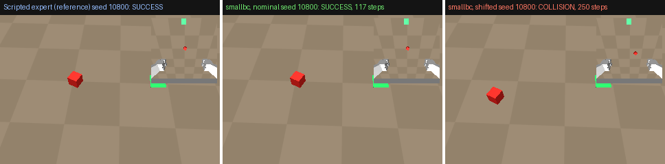

# sim-demo-to-policy

[](https://github.com/giridhar-shenoy/sim-demo-to-policy/actions/workflows/ci.yml)



*Left: scripted expert (reference) on held-out seed 10800. Middle: smallbc, the headline
policy, on the same seed. Right: smallbc's first failure in the shifted pose box (seed
10800 shifted): the cube starts beyond the training box, and the policy presses its
open fingers into the table short of it. Inset: the 96 px wrist image the policy sees.*

A MuJoCo pick-and-place environment on the Franka Panda, a scripted expert whose
demonstrations are recorded as LeRobot v3.0 datasets, two kinds of policy trained on a
laptop CPU (ACT through `lerobot-train`, and smallbc, a small from-scratch spatial-softmax
BC policy), and an evaluation harness with held-out seeds, a failure taxonomy and
confidence intervals.
It shows the whole demonstration-to-policy loop running end to end on a CPU, with every
success rate traceable to a per-episode CSV whose seeds never overlap the demonstrations.

smallbc, a 574k-parameter spatial-softmax BC policy trained in 66 minutes on a laptop
CPU, places the cube in 100/100 held-out episodes and 72/100 when the cube starts 8 cm
outside the training box. Six ACT runs with per-step delta actions scored 0/100; the
cause is worked through below.
<!-- sdp-report:headline:begin -->
smallbc (from-scratch CNN + spatial-softmax keypoints, MLP, absolute targets, 1000 demo seeds (half DART), batch 64; checkpoint 25000 of 50000 training steps, 66.5 min on the laptop CPU to that checkpoint, 985 demonstrations) succeeds in 100/100 (100 %, Wilson 95 % 96 %–100 %) held-out test episodes (seeds 10800–10899), and in 72/100 (72 %, Wilson 95 % 63 %–80 %) with the cube's start box shifted by 8 cm. On its own test seeds 10700–10799, ACT run 8 (run 7 + 200 demos, half with DART noise; 20000 training steps, 113.4 min on the laptop CPU, 198 demonstrations) succeeds in 63/100 (63 %, Wilson 95 % 53 %–72 %) nominal and 16/100 (16 %, Wilson 95 % 10 %–24 %) shifted episodes. On its own test seeds 10700–10799, ACT run 7 (run 2 + absolute TCP-target actions; 6000 training steps, 32.4 min on the laptop CPU, 50 demonstrations) succeeds in 57/100 (57 %, Wilson 95 % 47 %–66 %) nominal and 19/100 (19 %, Wilson 95 % 13 %–28 %) shifted episodes. The earlier runs 1–6, with per-step delta actions, score 0/100 each on their own test seeds.
<!-- sdp-report:headline:end -->

**Language split:** Python only. The imitation-learning stack (LeRobot, PyTorch,
gym-style MuJoCo envs) is Python.

## Run it

```bash
docker build -t sdp . && docker run --rm sdp scripts/regenerate_all.sh
```

This reruns everything inside the CI image and prints every number. Results written
inside the container are discarded when it exits.

Without Docker (Python 3.12; the venv is uv-managed because lerobot 0.6.1 caps torch at 2.11):

```bash
uv venv --python 3.12 .venv && source .venv/bin/activate
uv pip install -r requirements.lock --index-strategy unsafe-best-match \
  --extra-index-url https://download.pytorch.org/whl/cpu   # CPU torch; both indexes official
uv pip install --no-deps -e .
scripts/fetch_menagerie.sh && export SDP_MENAGERIE_DIR=$PWD/third_party/mujoco_menagerie MUJOCO_GL=egl
scripts/regenerate_all.sh   # about 6 h on a 4-core laptop CPU, ~4.5 h of it training
```

smallbc: `python -m sdp.policies.smallbc.record` records its demos (uint8 memmap shards,
not shipped; regenerated deterministically from demo seeds 0–999),
`python -m sdp.policies.smallbc.train` trains it, and `sdp eval --checkpoint <ckpt.pt>`
evaluates it (a `.pt` file selects smallbc, a directory selects ACT). The exact flags are
in `scripts/regenerate_all.sh`.

`regenerate_all.sh` measures env throughput, scores the scripted expert, records the
demos (50 at 96 and 128 px for ACT runs 1–6, 1000 seeds for smallbc), trains ACT runs 1–6
and smallbc, evaluates every policy on its dev and test seeds, renders the GIF and
rewrites the tables below. It does not retrain ACT runs 7 and 8: it evaluates their
checkpoints under `experiments/privileged/` if present, and on a fresh clone (where those
are gitignored) fetches `act_cpu_v7_abs` and `act_cpu_v8_abs_dart` from the
[v0.1.0 release](https://github.com/giridhar-shenoy/sim-demo-to-policy/releases/tag/v0.1.0)
with `scripts/fetch_release_asset.sh`. Retraining them is done by the scripts in
`experiments/privileged/run7/` and `run8/` (exact commands in their `NOTES.txt`).

## Use the trained policies

Every checkpoint and dataset behind the tables is attached to the
[v0.1.0 release](https://github.com/giridhar-shenoy/sim-demo-to-policy/releases/tag/v0.1.0):
13 `.tar.gz` archives, 583262517 bytes in total, each extracting to a directory of the same
name. `scripts/download_release_assets.sh` fetches all of them.

- `smallbc_abs1000_25k`: the headline policy, `ckpt_025000.pt` (573,650 parameters), and
  its training run's `config.json`.
- `act_cpu_v8_abs_dart` and `act_cpu_v7_abs`: ACT runs 8 (step 20000) and 7 (step 6000),
  absolute TCP-target actions.
- `act_cpu_scripted50`, `act_cpu_v2_scripted50`, `act_cpu_v3_scripted50`,
  `act_cpu_v4_scripted50`, `act_cpu_v5_scripted50_128px`, `act_cpu_v6_scripted50`: ACT
  runs 1–6 (per-step delta actions, 0/100 each), final checkpoints.
  Each ACT archive is a LeRobot `pretrained_model/` directory.
- `pickplace_abs_dart_200` (198 episodes, run 8), `pickplace_abs_50` (50, run 7),
  `pickplace_scripted_50` (50, runs 1–4 and 6), `pickplace_scripted_50_128px` (50, run 5):
  the LeRobot v3.0 datasets.

smallbc's dataset (5.8 GB) is not attached: `python -m sdp.policies.smallbc.record`
regenerates it deterministically from demo seeds 0–999 (flags in
`scripts/regenerate_all.sh`).

### Verify the headline without training

After the install steps above (no GitHub login needed):

```bash
mkdir -p outputs && curl -fsSL https://github.com/giridhar-shenoy/sim-demo-to-policy/releases/download/v0.1.0/smallbc_abs1000_25k.tar.gz \
  | tar -xz -C outputs
sha256sum outputs/smallbc_abs1000_25k/ckpt_025000.pt
# 2fe2485155b5aa96743b2f7b28e0d38793c35164f0bc9df836fefe7916bb296e
sdp eval --checkpoint outputs/smallbc_abs1000_25k/ckpt_025000.pt --condition smallbc_verify \
  --seed-start 800 --trials 100 --distributions nominal shifted --out outputs/verify/smallbc_s10800
```

`--seed-start` is an offset into the eval seeds, so this runs the official test seeds
10800–10899. Expected, the official result:

```text
smallbc_verify nominal: 100/100 (100 %, Wilson 95 % 96-100 %)
smallbc_verify shifted: 72/100 (72 %, Wilson 95 % 63-80 %)
```

It takes about 1.5 min on the laptop's CPU (the official runs took 36.3 s nominal and
49.0 s shifted). `outputs/verify/smallbc_s10800.csv` can be compared episode by episode
with `results/eval_smallbc_abs1000_25k_s10800_{nominal,shifted}.csv`; only the
`policy_ms_*` timing columns should differ. `--out` keeps the run out of `results/`, so
`sdp report` does not count it as a second official eval. On this laptop reruns are
identical episode by episode; on a different CPU, floating-point differences in MuJoCo or
PyTorch may change a few borderline episodes.

## Results

<!-- sdp-report:success:begin -->
| Policy / data | Cube poses | Seeds | Trials | Success | Wilson 95 % CI | Mean length, successes (steps) | Per-episode CSV |
|---|---|---|---|---|---|---|---|
| expert_demo_seeds | nominal | 0–99 | 100 | 100/100 (100 %) | 96 %–100 % | 109.9 | [`results/expert_pickplace.csv`](results/expert_pickplace.csv) |
| expert_eval_seeds | nominal | 10000–10099 | 100 | 100/100 (100 %) | 96 %–100 % | 110.6 | [`results/expert_pickplace.csv`](results/expert_pickplace.csv) |
| expert_eval_seeds | shifted | 10000–10099 | 100 | 100/100 (100 %) | 96 %–100 % | 117.2 | [`results/expert_pickplace.csv`](results/expert_pickplace.csv) |
| ACT run 1 (`act_cpu_scripted50`) | nominal | 10000–10099 | 100 | 0/100 (0 %) | 0 %–4 % | – | [`results/eval_act_cpu_scripted50_s10000.csv`](results/eval_act_cpu_scripted50_s10000.csv) |
| ACT run 1 (`act_cpu_scripted50`) | shifted | 10000–10099 | 100 | 0/100 (0 %) | 0 %–4 % | – | [`results/eval_act_cpu_scripted50_s10000.csv`](results/eval_act_cpu_scripted50_s10000.csv) |
| ACT run 1 (`act_cpu_scripted50`) | nominal | 10100–10199 | 100 | 0/100 (0 %) | 0 %–4 % | – | [`results/eval_act_cpu_scripted50_s10100.csv`](results/eval_act_cpu_scripted50_s10100.csv) |
| ACT run 1 (`act_cpu_scripted50`) | shifted | 10100–10199 | 100 | 0/100 (0 %) | 0 %–4 % | – | [`results/eval_act_cpu_scripted50_s10100.csv`](results/eval_act_cpu_scripted50_s10100.csv) |
| ACT run 2 (`act_cpu_v2_scripted50`) | nominal | 10100–10199 | 100 | 0/100 (0 %) | 0 %–4 % | – | [`results/eval_act_cpu_v2_scripted50_s10100.csv`](results/eval_act_cpu_v2_scripted50_s10100.csv) |
| ACT run 2 (`act_cpu_v2_scripted50`) | shifted | 10100–10199 | 100 | 0/100 (0 %) | 0 %–4 % | – | [`results/eval_act_cpu_v2_scripted50_s10100.csv`](results/eval_act_cpu_v2_scripted50_s10100.csv) |
| ACT run 3 (`act_cpu_v3_scripted50`) | nominal | 10200–10299 | 100 | 0/100 (0 %) | 0 %–4 % | – | [`results/eval_act_cpu_v3_scripted50_s10200.csv`](results/eval_act_cpu_v3_scripted50_s10200.csv) |
| ACT run 3 (`act_cpu_v3_scripted50`) | shifted | 10200–10299 | 100 | 0/100 (0 %) | 0 %–4 % | – | [`results/eval_act_cpu_v3_scripted50_s10200.csv`](results/eval_act_cpu_v3_scripted50_s10200.csv) |
| ACT run 4 (`act_cpu_v4_scripted50`) | nominal | 10300–10399 | 100 | 0/100 (0 %) | 0 %–4 % | – | [`results/eval_act_cpu_v4_scripted50_s10300.csv`](results/eval_act_cpu_v4_scripted50_s10300.csv) |
| ACT run 4 (`act_cpu_v4_scripted50`) | shifted | 10300–10399 | 100 | 0/100 (0 %) | 0 %–4 % | – | [`results/eval_act_cpu_v4_scripted50_s10300.csv`](results/eval_act_cpu_v4_scripted50_s10300.csv) |
| ACT run 5 (`act_cpu_v5_scripted50_128px`) | nominal | 10400–10499 | 100 | 0/100 (0 %) | 0 %–4 % | – | [`results/eval_act_cpu_v5_scripted50_128px_s10400.csv`](results/eval_act_cpu_v5_scripted50_128px_s10400.csv) |
| ACT run 5 (`act_cpu_v5_scripted50_128px`) | shifted | 10400–10499 | 100 | 0/100 (0 %) | 0 %–4 % | – | [`results/eval_act_cpu_v5_scripted50_128px_s10400.csv`](results/eval_act_cpu_v5_scripted50_128px_s10400.csv) |
| ACT run 6 (`act_cpu_v6_scripted50`) | nominal | 10600–10699 | 100 | 0/100 (0 %) | 0 %–4 % | – | [`results/eval_act_cpu_v6_scripted50_s10600.csv`](results/eval_act_cpu_v6_scripted50_s10600.csv) |
| ACT run 6 (`act_cpu_v6_scripted50`) | shifted | 10600–10699 | 100 | 0/100 (0 %) | 0 %–4 % | – | [`results/eval_act_cpu_v6_scripted50_s10600.csv`](results/eval_act_cpu_v6_scripted50_s10600.csv) |
| ACT run 7 (`act_cpu_v7_abs`) | nominal | 10700–10799 | 100 | 57/100 (57 %) | 47 %–66 % | 115.4 | [`results/eval_act_cpu_v7_abs_s10700.csv`](results/eval_act_cpu_v7_abs_s10700.csv) |
| ACT run 7 (`act_cpu_v7_abs`) | shifted | 10700–10799 | 100 | 19/100 (19 %) | 13 %–28 % | 117.9 | [`results/eval_act_cpu_v7_abs_s10700.csv`](results/eval_act_cpu_v7_abs_s10700.csv) |
| ACT run 8 (`act_cpu_v8_abs_dart`) | nominal | 10700–10799 | 100 | 63/100 (63 %) | 53 %–72 % | 114.6 | [`results/eval_act_cpu_v8_abs_dart_s10700.csv`](results/eval_act_cpu_v8_abs_dart_s10700.csv) |
| ACT run 8 (`act_cpu_v8_abs_dart`) | shifted | 10700–10799 | 100 | 16/100 (16 %) | 10 %–24 % | 127.8 | [`results/eval_act_cpu_v8_abs_dart_s10700.csv`](results/eval_act_cpu_v8_abs_dart_s10700.csv) |
| smallbc (`smallbc_abs1000_25k`) | nominal | 10700–10799 | 100 | 97/100 (97 %) | 92 %–99 % | 114.7 | [`results/eval_smallbc_abs1000_25k_s10700_nominal.csv`](results/eval_smallbc_abs1000_25k_s10700_nominal.csv) |
| smallbc (`smallbc_abs1000_25k`) | shifted | 10700–10799 | 100 | 70/100 (70 %) | 60 %–78 % | 121.1 | [`results/eval_smallbc_abs1000_25k_s10700_shifted.csv`](results/eval_smallbc_abs1000_25k_s10700_shifted.csv) |
| smallbc (`smallbc_abs1000_25k`) | nominal | 10800–10899 | 100 | 100/100 (100 %) | 96 %–100 % | 115.8 | [`results/eval_smallbc_abs1000_25k_s10800_nominal.csv`](results/eval_smallbc_abs1000_25k_s10800_nominal.csv) |
| smallbc (`smallbc_abs1000_25k`) | shifted | 10800–10899 | 100 | 72/100 (72 %) | 63 %–80 % | 124.6 | [`results/eval_smallbc_abs1000_25k_s10800_shifted.csv`](results/eval_smallbc_abs1000_25k_s10800_shifted.csv) |
<!-- sdp-report:success:end -->

Failure labels (one per episode, defined in [`sdp/eval/taxonomy.py`](sdp/eval/taxonomy.py)):

<!-- sdp-report:taxonomy:begin -->
| Policy / data | Cube poses | success | collision | never_reached | grasp_missed | dropped | placed_outside | timeout |
|---|---|---|---|---|---|---|---|---|
| expert_demo_seeds | nominal | 100 | 0 | 0 | 0 | 0 | 0 | 0 |
| expert_eval_seeds | nominal | 100 | 0 | 0 | 0 | 0 | 0 | 0 |
| expert_eval_seeds | shifted | 100 | 0 | 0 | 0 | 0 | 0 | 0 |
| ACT run 1 (`act_cpu_scripted50`) | nominal | 0 | 3 | 97 | 0 | 0 | 0 | 0 |
| ACT run 1 (`act_cpu_scripted50`) | shifted | 0 | 0 | 100 | 0 | 0 | 0 | 0 |
| ACT run 1 (`act_cpu_scripted50`) | nominal | 0 | 3 | 97 | 0 | 0 | 0 | 0 |
| ACT run 1 (`act_cpu_scripted50`) | shifted | 0 | 0 | 100 | 0 | 0 | 0 | 0 |
| ACT run 2 (`act_cpu_v2_scripted50`) | nominal | 0 | 7 | 93 | 0 | 0 | 0 | 0 |
| ACT run 2 (`act_cpu_v2_scripted50`) | shifted | 0 | 5 | 95 | 0 | 0 | 0 | 0 |
| ACT run 3 (`act_cpu_v3_scripted50`) | nominal | 0 | 13 | 87 | 0 | 0 | 0 | 0 |
| ACT run 3 (`act_cpu_v3_scripted50`) | shifted | 0 | 13 | 87 | 0 | 0 | 0 | 0 |
| ACT run 4 (`act_cpu_v4_scripted50`) | nominal | 0 | 0 | 100 | 0 | 0 | 0 | 0 |
| ACT run 4 (`act_cpu_v4_scripted50`) | shifted | 0 | 1 | 99 | 0 | 0 | 0 | 0 |
| ACT run 5 (`act_cpu_v5_scripted50_128px`) | nominal | 0 | 0 | 100 | 0 | 0 | 0 | 0 |
| ACT run 5 (`act_cpu_v5_scripted50_128px`) | shifted | 0 | 3 | 97 | 0 | 0 | 0 | 0 |
| ACT run 6 (`act_cpu_v6_scripted50`) | nominal | 0 | 15 | 82 | 2 | 0 | 1 | 0 |
| ACT run 6 (`act_cpu_v6_scripted50`) | shifted | 0 | 68 | 32 | 0 | 0 | 0 | 0 |
| ACT run 7 (`act_cpu_v7_abs`) | nominal | 57 | 0 | 3 | 37 | 3 | 0 | 0 |
| ACT run 7 (`act_cpu_v7_abs`) | shifted | 19 | 0 | 69 | 12 | 0 | 0 | 0 |
| ACT run 8 (`act_cpu_v8_abs_dart`) | nominal | 63 | 0 | 1 | 30 | 5 | 0 | 1 |
| ACT run 8 (`act_cpu_v8_abs_dart`) | shifted | 16 | 0 | 69 | 14 | 1 | 0 | 0 |
| smallbc (`smallbc_abs1000_25k`) | nominal | 97 | 0 | 0 | 0 | 3 | 0 | 0 |
| smallbc (`smallbc_abs1000_25k`) | shifted | 70 | 28 | 0 | 0 | 2 | 0 | 0 |
| smallbc (`smallbc_abs1000_25k`) | nominal | 100 | 0 | 0 | 0 | 0 | 0 | 0 |
| smallbc (`smallbc_abs1000_25k`) | shifted | 72 | 26 | 0 | 0 | 2 | 0 | 0 |
<!-- sdp-report:taxonomy:end -->

<!-- sdp-report:training:begin -->
| Run | Change from the base CPU config | Steps | Wall time | Final loss | Config |
|---|---|---|---|---|---|
| run 1 (`act_cpu_scripted50`) | base config; lr 1e-4, backbone lr 1e-5, CVAE on | 3000 | 21.0 min | 0.096 | `sdp/train/configs/act_cpu.yaml` |
| run 2 (`act_cpu_v2_scripted50`) | run 1 + backbone lr 1e-4, CVAE off | 3000 | 17.1 min | 0.082 | `sdp/train/configs/act_cpu_v2.yaml` |
| run 3 (`act_cpu_v3_scripted50`) | run 2 + 8000 steps instead of the base 3000 | 8000 | 45.3 min | 0.063 | `sdp/train/configs/act_cpu_v3.yaml` |
| run 4 (`act_cpu_v4_scripted50`) | run 2 + proprioceptive state withheld (cameras only) | 3000 | 17.2 min | 0.073 | `sdp/train/configs/act_cpu_v4.yaml` |
| run 5 (`act_cpu_v5_scripted50_128px`) | run 4 + 128 px cameras (demos re-recorded) | 3000 | 21.5 min | 0.079 | `sdp/train/configs/act_cpu_v5.yaml` |
| run 6 (`act_cpu_v6_scripted50`) | run 2 + lr 1e-5 and backbone lr 1e-5 (LeRobot defaults) | 3000 | 16.3 min | 0.114 | `sdp/train/configs/act_cpu_v6.yaml` |
| run 7 (`act_cpu_v7_abs`) | run 2 + absolute TCP-target actions | 6000 | 32.4 min | 0.065 | `experiments/privileged/run7/act_cpu_v7_abs.yaml` |
| run 8 (`act_cpu_v8_abs_dart`) | run 7 + 200 demos, half with DART noise | 20000 | 113.4 min | 0.070 | `experiments/privileged/run8/act_cpu_v8_abs_dart.yaml` |
| smallbc (`smallbc_abs1000_25k`) | from-scratch CNN + spatial-softmax keypoints, MLP, absolute targets, 1000 demo seeds (half DART), batch 64 | 25000 of 50000 | 66.5 min of 130.5 min | 0.057 | `experiments/smallbc/runs/abs1000/config.json` |
<!-- sdp-report:training:end -->

Stage wall times (recording and eval timings are saved from run 5 on):

<!-- sdp-report:timing:begin -->
| Run | Demo recording (50 episodes) | Training | Eval (200 episodes) |
|---|---|---|---|
| run 1 (`act_cpu_scripted50`) | – | 21.0 min | – |
| run 2 (`act_cpu_v2_scripted50`) | – | 17.1 min | – |
| run 3 (`act_cpu_v3_scripted50`) | – | 45.3 min | – |
| run 4 (`act_cpu_v4_scripted50`) | – | 17.2 min | – |
| run 5 (`act_cpu_v5_scripted50_128px`) | 55 s | 21.5 min | 5.0 min |
| run 6 (`act_cpu_v6_scripted50`) | – | 16.3 min | 4.5 min |
| run 7 (`act_cpu_v7_abs`) | 44 s | 32.4 min | 3.5 min |
| run 8 (`act_cpu_v8_abs_dart`) | – | 113.4 min | 3.4 min |
| smallbc (`smallbc_abs1000_25k`) | 140 s | 130.5 min | 1.4 min |
<!-- sdp-report:timing:end -->

Runs 7 and 8 were trained overnight; run 8's 20000 steps took 113.4 min.

Paired comparison on identical seeds (generated from the per-episode CSVs):

<!-- sdp-report:paired:begin -->
| Run A | Run B | Seeds | Cube poses | Both succeed | Only A | Only B | Neither | McNemar exact p |
|---|---|---|---|---|---|---|---|---|
| ACT run 7 | ACT run 8 | 10700–10799 | nominal | 40 | 17 | 23 | 20 | 0.4296 |
| ACT run 7 | ACT run 8 | 10700–10799 | shifted | 8 | 11 | 8 | 73 | 0.6476 |
| ACT run 7 | smallbc | 10700–10799 | nominal | 57 | 0 | 40 | 3 | 1.819e-12 |
| ACT run 7 | smallbc | 10700–10799 | shifted | 19 | 0 | 51 | 30 | 8.882e-16 |
| ACT run 8 | smallbc | 10700–10799 | nominal | 62 | 1 | 35 | 2 | 1.077e-09 |
| ACT run 8 | smallbc | 10700–10799 | shifted | 16 | 0 | 54 | 30 | 1.11e-16 |
<!-- sdp-report:paired:end -->

Training budget: 45 min per run on the laptop CPU. For run 3 only, I raised the cap from
45 to 50 min because the laptop was in use.

More tables (dataset, env throughput, seed ranges, pose boxes) and the command behind
every row: [docs/results.md](docs/results.md).

### smallbc: the headline policy

Code: [`sdp/policies/smallbc/`](sdp/policies/smallbc/), ported from
[`experiments/smallbc/`](experiments/smallbc/), the overnight experiment, kept as the
record. `sdp eval` on the package port reproduces the experiment's dev result episode by
episode (49/50 on all 50 seeds; [`results/repro/`](results/repro/)).

- **Model** (573,650 parameters, `results/config_smallbc_abs1000_25k.json`): per camera
  (front and wrist, 96 px), a from-scratch CNN with GroupNorm and strides 2-2-2-1,
  giving a 12×12 map, then a spatial-softmax head of 32 keypoints. An MLP takes the
  keypoints and a normalised 19-D proprio vector (the 15-D robot state plus the env's
  commanded TCP target [x, y, z, yaw]). It outputs a 16-step chunk of absolute targets
  [x, y, z, yaw, gripper]; 8 are executed, through the same abs→delta conversion as
  `AbsoluteTargetWrapper`, with the gripper binarised. It never sees the cube pose.
- **Data:** demo seeds 0–999, half with DART noise (std 0.3 on the executed x, y, z
  and yaw; labels stay the clean expert targets). 985 successful episodes are kept,
  111064 frames, split by episode into 100075 training and 10989 validation frames.
- **Training:** L1 loss on normalised targets, augmented with random shift only
  (replicate-pad 4 px, random crop back, independently per sample and per camera).
  Adam at lr 3e-4 with 500 warmup steps, then cosine; batch 64; 50000 steps in 130.5 min
  on the laptop CPU. The policy is the 25k checkpoint (66.5 min in), picked on dev seeds
  10500–10549 by a rule fixed before training.

### ACT vs smallbc is a recipe comparison

The gap between smallbc and ACT run 8 on the same seeds 10700–10799 (paired table above:
35 vs 1 discordant nominal, McNemar p 1.077e-09) is real, but it is not an architecture
result. smallbc had about 5× the demos (985 vs 198 episodes), batch 64 instead of 8
(25000 steps vs 20000, so about 10× as many training samples), a different chunk (16,
executing 8, vs ACT's 20, executing 10), and an extra proprio input (the commanded TCP
target). A clean comparison would train ACT on the same 1000-demo set with a comparable
sample budget, and smallbc on run 8's 198 episodes.

### Reading the numbers

Every ACT row is 100 independent episodes. Each episode's starting cube pose is fixed
by its seed. The 50 demonstrations use seeds 0–49, from the demo range 0–999. Eval
seeds come from 10000–19999, so the ranges cannot overlap: `sdp/seeds.py` enforces it
and `tests/test_seed_split.py` tests it. There were eight ACT runs and one smallbc run,
and each choice was made on data the later evaluation does not reuse:

- **Run 1** (the spec'd CPU config, 3000 steps) scored 0/100 on seeds 10000–10099,
  which therefore became the *dev* seeds.
- **Run 2** changed two settings (backbone lr 1e-5 → 1e-4, CVAE off) after a check on
  run 1's own training frames. Runs 1 and 2 were then scored once each on 10100–10199
  (*test 1*).
- **Run 3** is run 2 trained for 8000 steps instead of the spec'd 3000. I raised the
  step count because runs 1 and 2 underfit at 3000. It was scored once on fresh seeds
  10200–10299 (*test 2*).
- **Run 4** is run 2 with the proprioceptive state withheld from the policy (cameras
  only; the dataset is unchanged). It was scored once on fresh seeds 10300–10399 (*test
  3*). Its pass criterion for the diagnosis was written down before training
  (docs/results.md).
- **Run 5** is run 4 with both cameras at 128 px instead of 96; the 50 demos were
  re-recorded at 128 px from the same seeds (the expert still scores 100/100). It was
  scored once on fresh seeds 10400–10499 (*test 4*), with the same pre-registered
  criterion.
- **Run 6** is run 2 with the transformer and backbone learning rates set to 1e-5,
  LeRobot's ACT defaults, instead of 1e-4. It tests one hypothesis: runs 1–5 all
  trained the transformer at 1e-4, and that alone caused the collapse to a constant
  action chunk (a LeRobot user saw the same collapse on a similar dataset at 1e-4 and
  fixed it with these defaults). Swap sensitivity is checked at every saved checkpoint
  (1000, 2000, 3000), and the run is scored once on fresh seeds 10600–10699 (*test 5*).
- **Run 7** is run 2 with absolute TCP-target actions `[x, y, z, yaw, gripper]` instead
  of per-step deltas, trained for 6000 steps on 50 re-recorded demos from the same
  seeds. **Run 8** is run 7 with 200 demos, half of them with DART noise on the executed
  action and labelled with the clean expert targets (198 kept), and 20000 steps. Their
  checkpoints were picked on dev seeds 10500–10549, which makes those dev numbers
  slightly optimistic. Before any test eval I fixed run 8 @ 20k as the headline policy
  (docs/preregistration.md, commit 8060419), run 7 @ 6k as the minimal change, and seeds
  10700–10799 as the test set for both (*test 6*, paired). The plan also fixed a rule:
  no re-runs and no checkpoint swaps after seeing test results.
- **smallbc** @ 25k was picked on dev seeds 10500–10549 by a rule fixed before training
  (25k 49/50, 40k 48/50, last 48/50). Before any test eval I fixed it as the headline
  policy (docs/preregistration.md, commit 0d9b50d), with seeds 10800–10899 as its
  official test (*test 7*). It was also scored on 10700–10799, the ACT runs' test seeds,
  for the paired comparison.

No test seed range is reused for selection. 10700–10799 is shared on purpose, for the
paired comparison, and it was declared in advance. The headline is smallbc on its own
test seeds; ACT run 8 and run 7 follow on theirs.

The shifted condition reuses the same seeds with the cube's start box moved by
(+8 cm, −8 cm), so each shifted episode is a paired twin of a nominal one; about 22 %
of the shifted box still overlaps the training box. An episode counts as a success
only if the cube's centre ends inside the 6 cm square, resting on the table, with the
gripper open and the cube still, and all of that holds for 0.5 s within the 12.5 s
limit. The intervals are 95 % Wilson score intervals. With 100 trials a rate near
50 % carries about ±10 points, and 0/100 still allows up to 4 %. So differences under
~15 points between rows are not evidence, and one training seed per run says nothing
about seed-to-seed variance.

## Where it fails

- **smallbc outside the training pose box.** With the cube's start box moved by
  (+8 cm, −8 cm), smallbc succeeds in 72/100 (seeds 10800–10899) and 70/100
  (10700–10799). On 10800–10899 the failures are 26 `collision` and 2 `dropped`.
  Replaying the 26 collisions ([`results/collisions_smallbc_abs1000_25k_s10800_shifted.json`](results/collisions_smallbc_abs1000_25k_s10800_shifted.json))
  shows the same thing every time: the open fingers press into the table, a median 0.1438
  m short of a cube it never touches. Every one of those cubes started beyond the
  nominal box (start x 0.6112–0.67926 m, against the box's 0.60). Successes reach start
  x 0.64912 m. The policy interpolates inside the demo distribution and does not
  extrapolate far past it.
- **smallbc in the nominal box:** 100/100 on 10800–10899, and 97/100 on 10700–10799,
  where all 3 failures are `dropped`.
- **ACT, grasping.** Run 8 fails 37 of 100 nominal test episodes: 30 `grasp_missed`
  and 5 `dropped`, then 1 `never_reached` and 1 `timeout`. Run 7 fails 43: 37
  `grasp_missed`, 3 `dropped` and 3 `never_reached`. Shifted, both have 69
  `never_reached`.
- **One training seed per configuration,** so seed-to-seed variance is unmeasured,
  and the run 8 vs run 7 difference is not resolved (23 vs 17 discordant seeds, McNemar
  p 0.4296).
- **The ACT vs smallbc gap is a recipe comparison** (data, batch, chunk, inputs; see
  above), not a clean architecture comparison.
- **CPU-sized everything.** ACT: dim_model 256, 2/1 layers, ResNet-18 at 96 px (a 3×3
  map per camera), up to 20000 steps against LeRobot's 100k. smallbc: 573,650 parameters,
  50000 steps.
- **Only scripted data.** The demos come from one deterministic waypoint expert, plus
  DART noise in half of run 8's and smallbc's. Teleoperated demos are slower, noisier
  and multimodal, and that gap is unmeasured.
- **Per-step delta actions failed completely (runs 1–6),** all 0/100; see the next
  section.
- **No peg insertion and no So-101 yet.** The contact-rich task and the low-cost
  5-DoF arm are deferred.
- **Only one kind of shift.** The shifted condition moves the cube's start box. The
  lighting, colours, camera poses, target position and object are never varied.

## How the 0 % was debugged

Runs 1–6 all predicted the env's native action, a 7-D per-step delta of the TCP
target, and all scored 0/100. Their policies reproduced the descend, close, lift and
carry, but their first x/yaw outputs did not vary across episodes whose cubes sat in
different places (std ≤ 0.003; [`results/openloop_*.json`](results/)). Swapping in
other episodes' images barely moved those outputs, and runs 4–6 failed a pass
criterion fixed before training. Each run changed one factor, and none helped:

- run 2: backbone lr and CVAE;
- run 3: 8000 steps;
- run 4: the state withheld;
- run 5: 128 px;
- run 6: LeRobot's default lr 1e-5.

What found the cause ([`experiments/RETROSPECTIVE.md`](experiments/RETROSPECTIVE.md)):

1. **Integrity checks** ([`experiments/integrity/REPORT.md`](experiments/integrity/REPORT.md)).
   The pipeline is sound: the cube's position is recoverable from the frame-0 pixels
   with R² ≥ 0.994, open-loop replay is exact, there is no off-by-one, and
   normalisation is identical in training and eval.
2. **Learning rate alone (run 6):** 0/100, swap sensitivity 0.0009 / 0.0012 at the
   last checkpoint.
3. **Privileged state** ([`experiments/privileged/REPORT.md`](experiments/privileged/REPORT.md)).
   The cube pose replaced the cameras and run 2's architecture was kept. With delta
   actions: 0/50 (Wilson 0–7.1 %), and the cube pose barely moves the output (0.00014
   in x). With absolute TCP targets: 50/50 (92.9–100 %). In delta form the cube
   appears only in ~12 saturated approach frames per demo, and L1 regression settles
   on 0. In absolute form it sits in the target for 40+ frames and varies smoothly.
4. **Pixels + absolute targets (runs 7 and 8).** On run 7 @ 6k, swapping images moves
   the first-step action by 1.1522 in x and 1.9799 in yaw, in the wrapper's delta
   units (`experiments/privileged/run7/results/swap_sensitivity.json`). That passes
   the runs 4–6 criterion by more than 10×. The official test results are the
   headline above.

`sdp/envs/abs_target.py` (`AbsoluteTargetWrapper`, ported from
`experiments/privileged/priv_common.py`), `sdp record --action-mode abs_target` and the
eval adapter's action-mode detection bring the fix into the package. The repo's
`sdp eval` reproduces the experiment's run 7 dev result episode by episode (31/50 on
all 50 seeds: [`results/repro/`](results/repro/)).

## What transfers to hardware

The state half of the observation transfers almost as-is: the joint angles, the finger
gap and a TCP pose computed by forward kinematics are what a real Panda reports. The
image half does not. The sim cameras have no noise, blur, exposure change or distortion,
the lighting is flat, and the observation cameras draw collision meshes to stay fast.
The action is a 20 Hz delta TCP pose that the env turns into joint targets with damped
least-squares IK and near-perfect position actuators. On a real arm it would become a
Cartesian setpoint for a 1 kHz controller with velocity limits. That is the layer
ur5e-teaching-controllers implements (Jacobian TCP jogging, gravity-compensated hand
guiding), and the sim never shows the policy its lag or overshoot. Sim latency is zero
apart from the network's own compute, which the harness logs per episode. Resets are
free and exact here. On hardware they cost supervised robot time, and the seeds lose
their meaning. Contact is MuJoCo's soft model with elliptic cones, forgiving for a 50 g
cube; it would be the first gap to show on a contact-rich task. The longer version,
marked as a draft: [docs/hardware_transfer.md](docs/hardware_transfer.md).

## What I'd do next

- **A clean ACT vs smallbc comparison:** ACT on smallbc's 1000-demo set with a
  comparable sample budget, and smallbc on run 8's 198 episodes, on the same fresh
  seeds.
- **Cover the shifted box:** widen the demo pose distribution, or add demos beyond
  x 0.60, then re-test on fresh seeds. smallbc's collisions all come from cubes outside
  the box it was trained on.
- **ACT's grasp:** most of its nominal failures are `grasp_missed`. Try chunk-relative
  actions and more DART demos around the grasp.
- **Seeds and scale:** several training seeds per configuration, and a full-size run on
  a free GPU.
- **Teleoperated data**: keyboard teleop in the gym_hil key layout, then SpaceMouse,
  then the R3 retargeting pipeline as the teleop device. That would give a
  scripted-vs-teleop data comparison on the same eval seeds.
- **Diffusion policy** at the same CPU budget, and full-size ACT and diffusion runs
  (LeRobot defaults, 100k steps) in a Colab/Kaggle notebook.
- **Harder tasks**: PandaPegInsert (2 cm peg, 2.2 cm chamfered hole, contact-rich) and
  So101PickPlace (5-DoF low-cost arm, reduced workspace).
- **Data-size ablation** (10/25/50/100 demos) with several training seeds, so the
  intervals cover seed-to-seed variance and not just trial sampling.
- **Domain randomisation** beyond the object pose (lighting, colours, camera pose), then
  HIL-SERL-style fine-tuning in the gym_hil pattern.
- **Real-robot data** collected through R1's controllers, using the same dataset schema.

## Repository layout

| Path | What |
|---|---|
| `sdp/envs/` | `MujocoArmEnv` base (Menagerie loading, cameras, DLS IK, 500/20 Hz timing) and `PandaPickPlace-v0` |
| `sdp/expert/` | scripted waypoint expert |
| `sdp/record/` | LeRobot v3.0 writer + recorder (per-episode success sidecar) |
| `sdp/train/` | `lerobot-train` wrapper and the ACT CPU config |
| `sdp/policies/smallbc/` | smallbc: model, data, policy, `record` and `train` entry points |
| `sdp/eval/` | harness, failure taxonomy, Wilson intervals, ACT adapter, report generator |
| `scripts/` | one script per number or GIF; `regenerate_all.sh` runs them all |
| `results/` | per-episode CSVs and JSON summaries behind every table |
| `experiments/` | the debugging work: [retrospective](experiments/RETROSPECTIVE.md), integrity checks, privileged-state runs, runs 7/8, the original smallbc |
| `docs/` | [architecture](docs/architecture.md), [results](docs/results.md), [tasks](docs/tasks.md), [hardware transfer](docs/hardware_transfer.md) |

## License

MIT, see [LICENSE](LICENSE). Third-party components and their licenses:
[THIRD_PARTY.md](THIRD_PARTY.md).

Written with an AI coding agent working in my terminal; I set the scope, the constraints
and the acceptance criteria, reviewed the changes, and ran every benchmark.
