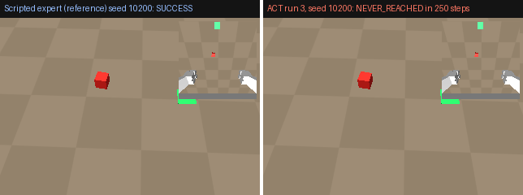

# sim-demo-to-policy

[](https://github.com/giridhar-shenoy/sim-demo-to-policy/actions/workflows/ci.yml)



*Left: scripted expert (reference) on held-out seed 10200. Right: ACT run 3 on the same
seed. It has learned the motion but not where the cube is (see "Where it fails").
Inset: the 96 px wrist image the policy sees.*

A MuJoCo pick-and-place environment on the Franka Panda, a scripted expert whose
demonstrations are recorded as a LeRobot v3.0 dataset, an ACT policy trained on a laptop
CPU with `lerobot-train`, and an evaluation harness with held-out seeds, a failure taxonomy
and confidence intervals.
It shows the whole demonstration-to-policy loop running end to end on a CPU, with every
success rate traceable to a per-episode CSV whose seeds never overlap the demonstrations.
<!-- sdp-report:headline:begin -->
None of the 6 ACT CPU runs succeeds: each scores 0/100 (0 %, Wilson 95 % 0 %–4 %) on 100 held-out nominal test episodes and 0/100 with the cube's start box shifted by 8 cm (run 1, seeds 10100–10199: spec'd config; lr 1e-4, backbone lr 1e-5, CVAE on; run 2, seeds 10100–10199: run 1 + backbone lr 1e-4, CVAE off; run 3, seeds 10200–10299: run 2 + 8000 steps instead of the spec'd 3000; run 4, seeds 10300–10399: run 2 + proprioceptive state withheld (cameras only); run 5, seeds 10400–10499: run 4 + 128 px cameras (demos re-recorded); run 6, seeds 10600–10699: run 2 + lr 1e-5 and backbone lr 1e-5 (LeRobot defaults)).
<!-- sdp-report:headline:end -->

**Language split:** Python only. The imitation-learning stack (LeRobot, PyTorch,
gym-style MuJoCo envs) is Python, and a C++ port would be unusual rather than impressive.
My C++ control and planning work is in
[ur5e-teaching-controllers](https://github.com/giridhar-shenoy/ur5e-teaching-controllers) and
[pointcloud-constrained-planning](https://github.com/giridhar-shenoy/pointcloud-constrained-planning).

## Run it

```bash
docker build -t sdp . && docker run --rm sdp scripts/regenerate_all.sh
```

This reruns everything inside the CI image and prints every number. Results written
inside the container are discarded when it exits.

Without Docker (Python 3.12; the venv is uv-managed because lerobot 0.6.1 caps torch at 2.11):

```bash
uv venv --python 3.12 .venv && source .venv/bin/activate
uv pip install -r requirements.lock --index-strategy unsafe-best-match \
  --extra-index-url https://download.pytorch.org/whl/cpu   # CPU torch; both indexes official
uv pip install --no-deps -e .
scripts/fetch_menagerie.sh && export SDP_MENAGERIE_DIR=$PWD/third_party/mujoco_menagerie MUJOCO_GL=egl
scripts/regenerate_all.sh   # ~3 h on a 4-core laptop CPU, ~2 h of it training
```

`regenerate_all.sh` measures env throughput, scores the scripted expert, records 50
demos (at 96 and 128 px), trains the five ACT runs, evaluates them on their dev and
test seeds, renders
the GIF and rewrites the tables below. Each checkpoint is 60–96 MB, too large to
commit. Until they are attached to a GitHub Release
(`scripts/download_release_assets.sh`), the script retrains them rather than
downloading them.

## Results

<!-- sdp-report:success:begin -->
| Policy / data | Cube poses | Seeds | Trials | Success | Wilson 95 % CI | Mean length, successes (steps) | Per-episode CSV |
|---|---|---|---|---|---|---|---|
| expert_demo_seeds | nominal | 0–99 | 100 | 100/100 (100 %) | 96 %–100 % | 109.9 | [`results/expert_pickplace.csv`](results/expert_pickplace.csv) |
| expert_eval_seeds | nominal | 10000–10099 | 100 | 100/100 (100 %) | 96 %–100 % | 110.6 | [`results/expert_pickplace.csv`](results/expert_pickplace.csv) |
| expert_eval_seeds | shifted | 10000–10099 | 100 | 100/100 (100 %) | 96 %–100 % | 117.2 | [`results/expert_pickplace.csv`](results/expert_pickplace.csv) |
| ACT run 1 (`act_cpu_scripted50`) | nominal | 10000–10099 | 100 | 0/100 (0 %) | 0 %–4 % | – | [`results/eval_act_cpu_scripted50_s10000.csv`](results/eval_act_cpu_scripted50_s10000.csv) |
| ACT run 1 (`act_cpu_scripted50`) | shifted | 10000–10099 | 100 | 0/100 (0 %) | 0 %–4 % | – | [`results/eval_act_cpu_scripted50_s10000.csv`](results/eval_act_cpu_scripted50_s10000.csv) |
| ACT run 1 (`act_cpu_scripted50`) | nominal | 10100–10199 | 100 | 0/100 (0 %) | 0 %–4 % | – | [`results/eval_act_cpu_scripted50_s10100.csv`](results/eval_act_cpu_scripted50_s10100.csv) |
| ACT run 1 (`act_cpu_scripted50`) | shifted | 10100–10199 | 100 | 0/100 (0 %) | 0 %–4 % | – | [`results/eval_act_cpu_scripted50_s10100.csv`](results/eval_act_cpu_scripted50_s10100.csv) |
| ACT run 2 (`act_cpu_v2_scripted50`) | nominal | 10100–10199 | 100 | 0/100 (0 %) | 0 %–4 % | – | [`results/eval_act_cpu_v2_scripted50_s10100.csv`](results/eval_act_cpu_v2_scripted50_s10100.csv) |
| ACT run 2 (`act_cpu_v2_scripted50`) | shifted | 10100–10199 | 100 | 0/100 (0 %) | 0 %–4 % | – | [`results/eval_act_cpu_v2_scripted50_s10100.csv`](results/eval_act_cpu_v2_scripted50_s10100.csv) |
| ACT run 3 (`act_cpu_v3_scripted50`) | nominal | 10200–10299 | 100 | 0/100 (0 %) | 0 %–4 % | – | [`results/eval_act_cpu_v3_scripted50_s10200.csv`](results/eval_act_cpu_v3_scripted50_s10200.csv) |
| ACT run 3 (`act_cpu_v3_scripted50`) | shifted | 10200–10299 | 100 | 0/100 (0 %) | 0 %–4 % | – | [`results/eval_act_cpu_v3_scripted50_s10200.csv`](results/eval_act_cpu_v3_scripted50_s10200.csv) |
| ACT run 4 (`act_cpu_v4_scripted50`) | nominal | 10300–10399 | 100 | 0/100 (0 %) | 0 %–4 % | – | [`results/eval_act_cpu_v4_scripted50_s10300.csv`](results/eval_act_cpu_v4_scripted50_s10300.csv) |
| ACT run 4 (`act_cpu_v4_scripted50`) | shifted | 10300–10399 | 100 | 0/100 (0 %) | 0 %–4 % | – | [`results/eval_act_cpu_v4_scripted50_s10300.csv`](results/eval_act_cpu_v4_scripted50_s10300.csv) |
| ACT run 5 (`act_cpu_v5_scripted50_128px`) | nominal | 10400–10499 | 100 | 0/100 (0 %) | 0 %–4 % | – | [`results/eval_act_cpu_v5_scripted50_128px_s10400.csv`](results/eval_act_cpu_v5_scripted50_128px_s10400.csv) |
| ACT run 5 (`act_cpu_v5_scripted50_128px`) | shifted | 10400–10499 | 100 | 0/100 (0 %) | 0 %–4 % | – | [`results/eval_act_cpu_v5_scripted50_128px_s10400.csv`](results/eval_act_cpu_v5_scripted50_128px_s10400.csv) |
| ACT run 6 (`act_cpu_v6_scripted50`) | nominal | 10600–10699 | 100 | 0/100 (0 %) | 0 %–4 % | – | [`results/eval_act_cpu_v6_scripted50_s10600.csv`](results/eval_act_cpu_v6_scripted50_s10600.csv) |
| ACT run 6 (`act_cpu_v6_scripted50`) | shifted | 10600–10699 | 100 | 0/100 (0 %) | 0 %–4 % | – | [`results/eval_act_cpu_v6_scripted50_s10600.csv`](results/eval_act_cpu_v6_scripted50_s10600.csv) |
<!-- sdp-report:success:end -->

Failure labels (one per episode, defined in [`sdp/eval/taxonomy.py`](sdp/eval/taxonomy.py)):

<!-- sdp-report:taxonomy:begin -->
| Policy / data | Cube poses | success | collision | never_reached | grasp_missed | dropped | placed_outside | timeout |
|---|---|---|---|---|---|---|---|---|
| expert_demo_seeds | nominal | 100 | 0 | 0 | 0 | 0 | 0 | 0 |
| expert_eval_seeds | nominal | 100 | 0 | 0 | 0 | 0 | 0 | 0 |
| expert_eval_seeds | shifted | 100 | 0 | 0 | 0 | 0 | 0 | 0 |
| ACT run 1 (`act_cpu_scripted50`) | nominal | 0 | 3 | 97 | 0 | 0 | 0 | 0 |
| ACT run 1 (`act_cpu_scripted50`) | shifted | 0 | 0 | 100 | 0 | 0 | 0 | 0 |
| ACT run 1 (`act_cpu_scripted50`) | nominal | 0 | 3 | 97 | 0 | 0 | 0 | 0 |
| ACT run 1 (`act_cpu_scripted50`) | shifted | 0 | 0 | 100 | 0 | 0 | 0 | 0 |
| ACT run 2 (`act_cpu_v2_scripted50`) | nominal | 0 | 7 | 93 | 0 | 0 | 0 | 0 |
| ACT run 2 (`act_cpu_v2_scripted50`) | shifted | 0 | 5 | 95 | 0 | 0 | 0 | 0 |
| ACT run 3 (`act_cpu_v3_scripted50`) | nominal | 0 | 13 | 87 | 0 | 0 | 0 | 0 |
| ACT run 3 (`act_cpu_v3_scripted50`) | shifted | 0 | 13 | 87 | 0 | 0 | 0 | 0 |
| ACT run 4 (`act_cpu_v4_scripted50`) | nominal | 0 | 0 | 100 | 0 | 0 | 0 | 0 |
| ACT run 4 (`act_cpu_v4_scripted50`) | shifted | 0 | 1 | 99 | 0 | 0 | 0 | 0 |
| ACT run 5 (`act_cpu_v5_scripted50_128px`) | nominal | 0 | 0 | 100 | 0 | 0 | 0 | 0 |
| ACT run 5 (`act_cpu_v5_scripted50_128px`) | shifted | 0 | 3 | 97 | 0 | 0 | 0 | 0 |
| ACT run 6 (`act_cpu_v6_scripted50`) | nominal | 0 | 15 | 82 | 2 | 0 | 1 | 0 |
| ACT run 6 (`act_cpu_v6_scripted50`) | shifted | 0 | 68 | 32 | 0 | 0 | 0 | 0 |
<!-- sdp-report:taxonomy:end -->

<!-- sdp-report:training:begin -->
| Run | Change from the spec'd CPU config | Steps | Wall time | Final loss | Config |
|---|---|---|---|---|---|
| run 1 (`act_cpu_scripted50`) | spec'd config; lr 1e-4, backbone lr 1e-5, CVAE on | 3000 | 21.0 min | 0.096 | `sdp/train/configs/act_cpu.yaml` |
| run 2 (`act_cpu_v2_scripted50`) | run 1 + backbone lr 1e-4, CVAE off | 3000 | 17.1 min | 0.082 | `sdp/train/configs/act_cpu_v2.yaml` |
| run 3 (`act_cpu_v3_scripted50`) | run 2 + 8000 steps instead of the spec'd 3000 | 8000 | 45.3 min | 0.063 | `sdp/train/configs/act_cpu_v3.yaml` |
| run 4 (`act_cpu_v4_scripted50`) | run 2 + proprioceptive state withheld (cameras only) | 3000 | 17.2 min | 0.073 | `sdp/train/configs/act_cpu_v4.yaml` |
| run 5 (`act_cpu_v5_scripted50_128px`) | run 4 + 128 px cameras (demos re-recorded) | 3000 | 21.5 min | 0.079 | `sdp/train/configs/act_cpu_v5.yaml` |
| run 6 (`act_cpu_v6_scripted50`) | run 2 + lr 1e-5 and backbone lr 1e-5 (LeRobot defaults) | 3000 | 16.3 min | 0.114 | `sdp/train/configs/act_cpu_v6.yaml` |
<!-- sdp-report:training:end -->

Stage wall times (recording and eval timings are saved from run 5 on):

<!-- sdp-report:timing:begin -->
| Run | Demo recording (50 episodes) | Training | Eval (200 episodes) |
|---|---|---|---|
| run 1 (`act_cpu_scripted50`) | – | 21.0 min | – |
| run 2 (`act_cpu_v2_scripted50`) | – | 17.1 min | – |
| run 3 (`act_cpu_v3_scripted50`) | – | 45.3 min | – |
| run 4 (`act_cpu_v4_scripted50`) | – | 17.2 min | – |
| run 5 (`act_cpu_v5_scripted50_128px`) | 55 s | 21.5 min | 5.0 min |
| run 6 (`act_cpu_v6_scripted50`) | – | 16.3 min | 4.5 min |
<!-- sdp-report:timing:end -->

Training budget: 45 min per run on the laptop CPU. For run 3 only, Giri raised the cap
from 45 to 50 min because the laptop was in use. Run 3 took three attempts at the same
config. Attempt 1 (45-min cap) was stopped at step ~1190 when it projected ~47 min.
Attempt 2 (50-min cap, laptop busy with another ROS project) was stopped at step ~4065
when it projected ~55 min. Neither was evaluated; their partial outputs are kept but
not reported. The run in the tables is attempt 3, from scratch, with only a browser
running: 45.3 min (2719.1 s) in one continuous segment, inside the 50-min cap
(0.3 min over the original 45), so the resume-from-checkpoint fallback was not needed.

More tables (dataset, env throughput, seed ranges, pose boxes) and the command behind
every row: [docs/results.md](docs/results.md).

### Reading the numbers

Every ACT row is 100 independent episodes. Each episode's starting cube pose is fixed
by its seed. The 50 demonstrations use seeds 0–49, from the demo range 0–999. Eval
seeds come from 10000–19999, so the ranges cannot overlap: `sdp/seeds.py` enforces it
and `tests/test_seed_split.py` tests it. There were six training runs, and each
choice was made on data the later evaluation does not reuse:

- **Run 1** (the spec'd CPU config, 3000 steps) scored 0/100 on seeds 10000–10099,
  which therefore became the *dev* seeds.
- **Run 2** changed two settings (backbone lr 1e-5 → 1e-4, CVAE off) after a check on
  run 1's own training frames. Runs 1 and 2 were then scored once each on 10100–10199
  (*test 1*).
- **Run 3** is run 2 trained for 8000 steps instead of the spec'd 3000. The step count
  is a deliberate departure from the spec, approved because runs 1 and 2 underfit at
  3000. It was scored once on fresh seeds 10200–10299 (*test 2*).
- **Run 4** is run 2 with the proprioceptive state withheld from the policy (cameras
  only; the dataset is unchanged). It was scored once on fresh seeds 10300–10399
  (*test 3*). Its pass criterion for the diagnosis was written down before training
  (NOTES.md).
- **Run 5** is run 4 with both cameras at 128 px instead of 96; the 50 demos were
  re-recorded at 128 px from the same seeds (the expert still scores 100/100). It was
  scored once on fresh seeds 10400–10499 (*test 4*), with the same pre-registered
  criterion.
- **Run 6** is run 2 with the transformer and backbone learning rates set to 1e-5,
  LeRobot's ACT defaults, instead of 1e-4. It tests one hypothesis: runs 1–5 all
  trained the transformer at 1e-4, and that alone caused the collapse to a constant
  action chunk (a LeRobot user saw the same collapse on a similar dataset at 1e-4 and
  fixed it with these defaults). Swap sensitivity is checked at every saved checkpoint
  (1000, 2000, 3000), and the run is scored once on fresh seeds 10600–10699 (*test 5*).

No test seed range is reused across experiments. The headline reports the best run on
its own test seeds and lists every run.

The shifted condition reuses the same seeds with the cube's start box moved by
(+8 cm, −8 cm), so each shifted episode is a paired twin of a nominal one; about 22 %
of the shifted box still overlaps the training box. An episode counts as a success
only if the cube's centre ends inside the 6 cm square, resting on the table, with the
gripper open and the cube still, and all of that holds for 0.5 s within the 12.5 s
limit. The intervals are 95 % Wilson score intervals. With 100 trials a rate near
50 % carries about ±10 points, and 0/100 still allows up to 4 %. So differences under
~15 points between rows are not evidence, and one training seed per run says nothing
about seed-to-seed variance.

## Where it fails

- **The ACT policy does not go to the cube.** All six CPU runs score 0/100, nominal
  and shifted, each on its own test seeds. In runs 1–5, 87–100 % of the episodes are
  `never_reached` and the rest are `collision` (fingers pressed into the table). The
  policy descends straight down from the home pose instead of first moving over the
  cube. On its own training frames it reproduces the descend, close, lift and carry
  actions. But its first x, y and yaw outputs are essentially identical (std ≤ 0.003)
  across 20 training episodes whose cubes sit in different places, while the recorded
  actions vary (std 0.38 in x, 0.55 in yaw) ([`results/openloop_*.json`](results/)).
  Each run also fails from its own training seeds (0/10 on demo seeds 0–9;
  [`results/trainseeds_*.json`](results/), a diagnostic, not an eval). Runs 2–5 each
  changed one factor, but all of them trained the transformer at lr 1e-4, which run 6
  tests separately. None changed the result:
  - **Run 2:** optimisation settings (backbone lr 1e-4, CVAE off).
  - **Run 3:** training length (8000 steps ≈ 11.6 epochs, final loss 0.063 vs 0.082).
  - **Run 4:** the proprioceptive shortcut (the 15-D state, which predicts every phase
    except the ~13 approach frames per episode). With only the cameras as input the
    policy still tracks the task's phases from the images: on episode 0 its z and
    gripper errors match run 2's. But its approach actions do not depend on the
    images. Swapping in other episodes' images moves the first-step x and yaw by
    0.0000 and 0.0001, and black images move z and the gripper but not x or yaw.
  - **Run 5:** image resolution (128 px, a 4×4 instead of 3×3 ResNet-18 feature map,
    the cube ~8–13 px). Same picture: swap change 0.0001 in x and yaw, std 0.0000.
    Both runs 4 and 5 fail the pass criterion fixed before training (a ≥ 0.1 change
    and ≥ 0.1 std in x or yaw).
  - **Run 6:** the learning rate (transformer and backbone at 1e-5, LeRobot's
    defaults, instead of 1e-4; the hypothesis from a LeRobot user who saw the same
    collapse at 1e-4). The images matter a little more but still far too little.
    Image-swap sensitivity in x / yaw is 0.0031 / 0.0029 at step 1000, 0.0018 / 0.0018
    at 2000 and 0.0009 / 0.0012 at 3000: 10–30× runs 1–5, but 30–100× below the 0.1
    threshold, and it shrinks as training goes on. The criterion is not met at any
    checkpoint. Its failures spread out (nominal: 82 `never_reached`, 15 `collision`,
    2 `grasp_missed`, 1 `placed_outside`; shifted: 68 `collision`, 32 `never_reached`),
    and in one nominal episode the cube was lifted. Since the approach still ignores
    the images, that is most likely a cube lying under the average trajectory. At
    lr 1e-5 the 3000-step budget also fits the arm's phases less tightly (episode-0
    z / gripper errors 0.136 / 0.104 vs 0.083 / 0.012 for run 2).

  So the learning rate alone is not the cause. With the reference fix, the policy
  still converges toward the mean approach action. What is left points at the data
  and the objective. The cube-dependent actions are
  the approach frames: 13.1 per episode on average (8–18), 11.9 % of all targets.
  About a third of their x/yaw values sit at the ±0.6 saturation. An L1-trained policy
  reaches a low loss by predicting their mean, about 0, and nothing in 3000–8000 CPU
  steps at either learning rate pushes it off that. This is a training failure, not distribution shift. The shifted
  condition says nothing yet, because there is no nominal success to lose.
- **Only scripted data.** All 50 demos come from one deterministic waypoint expert, so
  every demonstration follows the same path with the same timing. That is the easiest
  data an imitation learner can get. Teleoperated demos are slower, noisier and
  multimodal, and they are what the method has to handle on a real robot. There is no
  teleop row because teleop needs a person at the keyboard; that scripted-vs-teleop gap
  is unmeasured.
- **Image resolution.** At 96×96 the 4 cm cube covers 41–59 pixels (a bounding box
  6–10 px wide) in the front image, measured over 20 eval seeds per distribution, and
  ResNet-18 reduces each 96 px image to a 3×3 feature map. Its yaw is barely
  resolvable from the front view. The dilated last stage that would give a 6×6 map is
  not available for ResNet-18 in torchvision.
- **CPU-sized model and schedule.** dim_model 256, 2 encoder and 1 decoder layers,
  batch 8: 3000 steps is about 4.4 epochs over 5.5k frames, and run 3's 8000 steps
  about 11.6. Each run uses one training seed. LeRobot's defaults are 100k steps.
  These rates describe this budget, not ACT.
- **No peg insertion and no So-101 yet.** The contact-rich task and the low-cost
  5-DoF arm are deferred, so nothing here says how the pipeline does on contact-rich
  manipulation or on a reduced workspace.
- **Only one kind of shift.** The shifted condition moves the cube's start box. The
  lighting, colours, camera poses, target position and object are never varied.

### Delta vs absolute actions (follow-up in progress)

All six ACT runs above predict the env's native action, a 7-D per-step delta of the TCP
target. A follow-up isolated that choice. It is not one of the published runs: the
code, logs and results are under `experiments/privileged/` and `experiments/integrity/`
for now. The cameras were replaced by the true cube pose (privileged state), and run 2's
architecture was trained at lr 1e-4 and batch 32 for 6000 steps:

| Action representation | Eval seeds 10500–10549 | Wilson 95 % | Own demo seeds 0–9 |
|---|---|---|---|
| 7-D per-step delta (as in runs 1–6) | 0/50 | 0–7 % | 0/10 |
| 5-D absolute TCP target `[x, y, z, yaw, gripper]` | 50/50 | 93–100 % | 10/10 |

With deltas, the policy ignores even the cube pose: swapping in another episode's pose
moves the first action by at most 0.0017. With absolute targets, the first action
tracks the pose (correlation 0.997 in x, 0.974 in yaw). An integrity check found no
pipeline fault: the cube position is recoverable from the pixels (R² ≥ 0.994), replay
is exact, and normalisation matches between training and eval.

So the action representation, not the vision path, is what the six runs got wrong.
With deltas, the cube's position appears only in the ~13 approach frames per demo,
mostly as saturated pulses, and L1 regression settles on their mean. The package now
supports the absolute form: `sdp record --action-mode abs_target` records the target
the env holds after each step, `AbsoluteTargetWrapper` (`sdp/envs/abs_target.py`)
replays it, and the ACT eval adapter picks the mode from the checkpoint's action shape.
A pixel-based ACT run with absolute targets is in progress.

## What transfers to hardware

The state half of the observation transfers almost as-is: the joint angles, the finger
gap and a TCP pose computed by forward kinematics are what a real Panda reports. The
image half does not. The sim cameras have no noise, blur, exposure change or
distortion, the lighting is flat, and the observation cameras draw collision meshes
to stay fast. The action is a 20 Hz delta TCP pose that the env turns into joint
targets with damped least-squares IK and near-perfect position actuators. On a real
arm it would become a Cartesian setpoint for a 1 kHz controller with velocity limits.
That is the layer I built on production 6-axis arms (Jacobian TCP jogging,
gravity-compensated hand guiding), and the sim never shows the policy its lag or
overshoot. Sim latency is zero apart from the network's own compute, which the harness
logs per episode. Resets are free and exact here. On hardware they cost supervised
robot time, and the seeds lose their meaning. Contact is MuJoCo's soft model with
elliptic cones, forgiving for a 50 g cube; it would be the first gap to show on a
contact-rich task. The longer version, marked as a draft:
[docs/hardware_transfer.md](docs/hardware_transfer.md).

## What I'd do next

- **Make ACT localise the cube** before anything else. At transformer lr 1e-4,
  neither training length (run 3), nor withholding the state (run 4), nor resolution
  (run 5) helped. Run 6 showed that LeRobot's default lr 1e-5 doesn't help on its own
  either. Several factors are probably wrong at once, so the next steps are an
  end-to-end proof first (a privileged-state baseline, overfitting a few demos), then
  the data and objective:
  - oversample or up-weight the approach frames;
  - give the expert a slower, unsaturated approach, so there are more approach frames
    and their x/yaw targets vary smoothly with the cube's position;
  - add an auxiliary cube-position loss during training only;
  - train at full size on a free GPU.

  Accept a change only when the open-loop image-swap test moves the approach actions.
- **Teleoperated data**: keyboard teleop in the gym_hil key layout, then SpaceMouse,
  then the R3 retargeting pipeline as the teleop device. That would give a
  scripted-vs-teleop data comparison on the same eval seeds.
- **Diffusion policy** at the same CPU budget, and full-size ACT and diffusion runs
  (LeRobot defaults, 100k steps) in a Colab/Kaggle notebook.
- **Harder tasks**: PandaPegInsert (2 cm peg, 2.2 cm chamfered hole, contact-rich) and
  So101PickPlace (5-DoF low-cost arm, reduced workspace).
- **Data-size ablation** (10/25/50/100 demos) with several training seeds, so the
  intervals cover seed-to-seed variance and not just trial sampling.
- **Domain randomisation** beyond the object pose (lighting, colours, camera pose), then
  HIL-SERL-style fine-tuning in the gym_hil pattern.
- **Real-robot data** collected through R1's controllers, using the same dataset schema.

## Repository layout

| Path | What |
|---|---|
| `sdp/envs/` | `MujocoArmEnv` base (Menagerie loading, cameras, DLS IK, 500/20 Hz timing) and `PandaPickPlace-v0` |
| `sdp/expert/` | scripted waypoint expert |
| `sdp/record/` | LeRobot v3.0 writer + recorder (per-episode success sidecar) |
| `sdp/train/` | `lerobot-train` wrapper and the ACT CPU config |
| `sdp/eval/` | harness, failure taxonomy, Wilson intervals, ACT adapter, report generator |
| `scripts/` | one script per number or GIF; `regenerate_all.sh` runs them all |
| `results/` | per-episode CSVs and JSON summaries behind every table |
| `docs/` | [architecture](docs/architecture.md), [results](docs/results.md), [tasks](docs/tasks.md), [hardware transfer](docs/hardware_transfer.md) |

## License

MIT, see [LICENSE](LICENSE). Third-party components and their licenses:
[THIRD_PARTY.md](THIRD_PARTY.md).
