# Architecture

Everything is Python: the env and expert drive MuJoCo directly, the dataset and
policy are stock LeRobot 0.6.1, and the harness, taxonomy and report are this repo's.

```mermaid
flowchart LR
  subgraph SIM["sdp.envs — PandaPickPlace-v0 (MuJoCo 3.17)"]
    direction TB
    ACT_IN["action a ∈ [-1,1]^7<br/>Δx Δy Δz Δroll Δpitch Δyaw, gripper"]
    TGT["integrated TCP target<br/>workspace box, tilt ≤ 0.5 rad, |yaw| ≤ π/2"]
    IK["damped least-squares IK<br/>4 iters, λ = 0.05, posture bias"]
    ACTU["Panda position actuators (Menagerie)<br/>+ gravity compensation"]
    PHYS["physics 500 Hz × 25 substeps = 20 Hz control"]
    OBS["obs: front + wrist RGB 96×96,<br/>state 15-D (TCP pose 7, gripper gap 1, joints 7)"]
    INFO["info: cube pose, grasp/contact flags,<br/>success = in square + released + still for 0.5 s"]
    ACT_IN --> TGT --> IK --> ACTU --> PHYS --> OBS
    PHYS --> INFO
  end

  EXP["sdp.expert<br/>scripted waypoint expert<br/>(privileged cube pose)"]
  REC["sdp.record<br/>LeRobotDataset.create / add_frame /<br/>save_episode / finalize"]
  DS[("datasets/pickplace_scripted_50<br/>LeRobot v3.0, AV1 video<br/>+ meta/sdp_episodes.jsonl")]
  TRAIN["sdp.train → lerobot-train<br/>ACT CPU config (YAML → --a.b=v)"]
  CKPT[("outputs/train/…/pretrained_model<br/>weights + pre/post processors")]
  EVAL["sdp.eval harness<br/>eval seeds 10000–19999,<br/>nominal + shifted poses"]
  TAX["sdp.eval.taxonomy<br/>one failure label per episode"]
  RES[("results/*.csv (per episode)<br/>results/*.json (Wilson 95 %)")]
  REP["sdp report"]
  DOCS["README.md, docs/results.md"]

  EXP -- "demo seeds 0–999" --> ACT_IN
  OBS --> REC
  EXP --> REC
  REC --> DS --> TRAIN --> CKPT --> EVAL
  EVAL <-- "obs / action" --> SIM
  EVAL --> TAX --> RES --> REP --> DOCS

  TELEOP["sdp.teleop (keyboard, SpaceMouse, R3 bridge)<br/>not in v0.1"]
  TELEOP -. "what's next" .-> ACT_IN
```

## Timing

| Loop | Rate | Where |
|---|---|---|
| MuJoCo physics | 500 Hz (dt 2 ms) | `MujocoArmEnv.physics_hz` |
| Control / policy step | 20 Hz (25 substeps) | `MujocoArmEnv.control_hz` |
| ACT re-plan | every 10 steps (0.5 s), 20-step chunks | `act_cpu.yaml` `n_action_steps`, `chunk_size` |

## Data contract (dataset features)

| Feature | dtype / shape | Notes |
|---|---|---|
| `observation.images.front` | video 96×96×3 | fixed camera across the table |
| `observation.images.wrist` | video 96×96×3 | on the hand, looking past the fingertips |
| `observation.state` | float32 (15,) | TCP xyz, TCP quaternion (w,x,y,z; sign fixed to the home orientation), finger gap (m), 7 joint angles |
| `action` | float32 (7,) | normalised Δ TCP pose (2 cm and 0.1 rad per step at ±1), gripper (+1 open, −1 closed) |
| `next.reward`, `next.done`, `next.success` | float32 / bool (1,) | per frame |
| `task` | string | "Pick up the red cube and place it in the green square." |

Per-episode metadata (seed, pose distribution, success flag, failure label, source)
lives in `meta/sdp_episodes.jsonl` beside LeRobot's own metadata.
